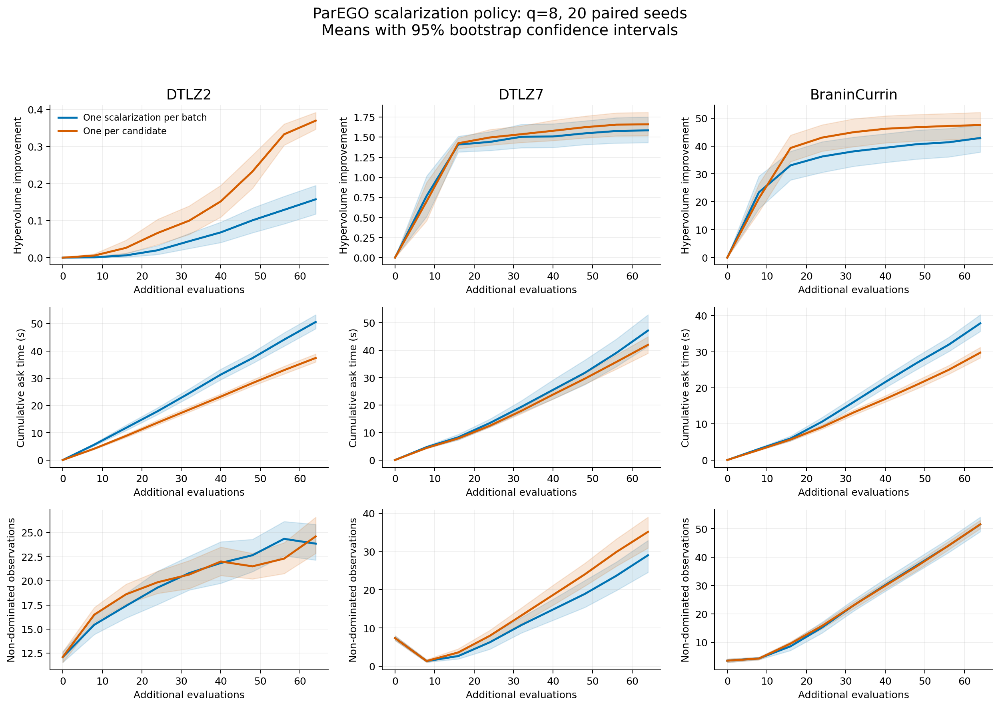

# Does ParEGO need a different scalarization for each batch candidate?

**Expanded study:** see the [six-problem q=4 and q=8 report](extended_results/report.md), with 20 paired seeds per case and a matched final budget of 80 observations. It includes five-objective DTLZ2, ZDT3, and VehicleSafety, plus the original problems. The original three-problem results below are retained for provenance; use the expanded report for the full comparison and its multiple-testing adjustment.

This experiment compares two scalarization policies inside BoFire's existing ParEGO strategy. Production BoFire code was not changed. Both variants use qLogNEI and sequential pending-aware candidate generation.

At this budget, per-candidate scalarization has a clear positive final-hypervolume effect on DTLZ2, BraninCurrin. The result on DTLZ7 is inconclusive after accounting for seed variation. These results support independent scalarizations when learning a Pareto front, while leaving room for problem-dependent behavior.



Measurements were collected on 4 November 2026 using the experimental strategy subclass in the accompanying script, based on workspace commit `f246935bcb36112cf95b5e828ddda72ab2d9c19e` and the environment in [config.json](results/config.json). They compare scalarization policies, rather than a before/after rerun of the final production PR. The production qParEGO implementation at that commit is unchanged on the PR's base, `00f9dabe3`. The fix and regression tests are validated against that latest `main` snapshot.

## Design

- 20 matched seeds per problem; 16 initial Sobol points; 8 rounds of 8 candidates (80 total observations).
- 128 MC samples, 4 restarts, 128 raw samples, maxiter=200.
- CPU double precision; 1 PyTorch thread; BoTorch 0.18.1.
- 4 independent worker processes; measured wall times include shared CPU contention.
- DTLZ2: 6 inputs / 3 objectives / spherical front; reference (1.1, 1.1, 1.1).
- DTLZ7: 6 inputs / 3 objectives / disconnected front; reference (1.1, 1.1, 7.0).
- Branin–Currin: 2 inputs / 2 objectives; reference (18, 6).
- Outcomes are noiseless; all objectives are minimized. These are short-horizon synthetic tests.
- Both variants share initial designs and the first scalarization each round. Separate RNG streams control scalarizations, MC samplers, GP fitting, and optimizer initialization. Extra scalarization draws do not advance the optimizer stream. Execution order alternates by seed.
- The q=1 control produced identical candidates, objective values, and weights. A runtime assertion checks one unique weight vector per batch versus q unique vectors per candidate.

## Final quality and runtime

| Problem | Policy | Final HV, mean ± SD | HV gain, mean ± SD | Mean ask/batch |
|---|---|---:|---:|---:|
| DTLZ2 | One scalarization per batch | 0.3315 ± 0.1030 | 0.1575 ± 0.0901 | 6.33 s |
| DTLZ2 | One per candidate | 0.5438 ± 0.0516 | 0.3698 ± 0.0532 | 4.68 s |
| DTLZ7 | One scalarization per batch | 1.5842 ± 0.3714 | 1.5842 ± 0.3714 | 5.89 s |
| DTLZ7 | One per candidate | 1.6595 ± 0.3365 | 1.6595 ± 0.3365 | 5.24 s |
| BraninCurrin | One scalarization per batch | 50.9855 ± 3.3506 | 42.8821 ± 11.5090 | 4.73 s |
| BraninCurrin | One per candidate | 55.6257 ± 1.7828 | 47.5222 ± 11.1793 | 3.72 s |

## Paired comparison

Positive differences favor one scalarization per candidate. Confidence intervals bootstrap the 20 matched-seed differences (20,000 resamples); p-values use two-sided Wilcoxon signed-rank tests with Holm adjustment across the three problems.

| Problem | Mean paired final-HV difference | 95% CI | Wins / losses / ties | Holm-adjusted p |
|---|---:|---:|---:|---:|
| DTLZ2 | +0.21226 | [+0.17002, +0.25508] | 19 / 1 / 0 | 7.629e-06 |
| DTLZ7 | +0.07530 | [-0.06799, +0.20632] | 15 / 5 / 0 | 0.1231 |
| BraninCurrin | +4.64017 | [+3.33351, +6.12928] | 20 / 0 / 0 | 5.722e-06 |

## Interpretation and limitations

Hypervolume is the primary quality metric. Non-dominated-point counts provide supporting information about the attained front, but do not by themselves measure uniform coverage or closeness to the true front. Batch objective distances are logged as diagnostics; distance alone can reward poor solutions.

This tests scalarization policy within BoFire; it does not benchmark Ax execution. A policy can be sensible for a particular preference or application even if it performs worse on these front-learning benchmarks. Reference points, batch size, noise, optimizer budget, and evaluation horizon can change the result. GP fitting and candidate-generation time are recorded separately. Warnings are counted in the raw results; automatic optimizer retries remain included in timing.

The shared policy draws 8 trade-off directions over the run; the per-candidate policy draws 64. This difference is particularly relevant when the aim is to learn an entire Pareto front within a small number of batch rounds. The tests cover two and three objectives; Ax's default ParEGO regime with five or more objectives was not tested.

## Artifacts

- [Complete configuration](results/config.json)
- [All per-round results](results/all_results.csv)
- [Summary](results/summary.csv)
- [Paired statistics](results/paired_comparisons.csv)
- [Pairing audit](results/pairing_audit.csv) (initial design, monotonic hypervolume, logged weights, and first-candidate checks)
- [SVG figure](results/comparison.svg)
- [Raw run and candidate files](results/raw_runs.zip): 240 CSVs containing all 120 runs, including true outcomes and scalarization weights.
- [Benchmark script](benchmark_parego_scalarization.py)
- [Analysis script](analyze_parego_scalarization.py)

## Background

- [BoTorch qNParEGO tutorial](https://botorch.org/docs/v0.17.2/tutorials/multi_objective_bo): separate scalarizations per candidate.
- [BoFire issue #849](https://github.com/experimental-design/bofire/issues/849): shared scalarization in current batch generation.
- [Ax acquisition construction](https://github.com/facebook/Ax/blob/5a7b3367f2d372e1653fd6c6ff1eaf8069ecc850/ax/generators/torch/botorch_modular/acquisition.py#L348-L364): the standard path constructs one acquisition object.

Reproduce from the repository root:

```bash
# Regenerate figures and statistics from the recorded runs.
unzip -n benchmark/results/raw_runs.zip -d benchmark/results
conda run -n bofire python benchmark/analyze_parego_scalarization.py benchmark/results

# Or run a new paired experiment. The script checkpoints completed runs.
PYTHONPATH=. OMP_NUM_THREADS=1 OPENBLAS_NUM_THREADS=1 conda run --no-capture-output -n bofire python benchmark/benchmark_parego_scalarization.py --output output/parego_scalarization
```

Reproduce the expanded study from this checkout:

```bash
# Restore the recorded runs and regenerate the expanded report and figures.
unzip -n benchmark/extended_results/raw_runs.zip -d benchmark/extended_results
conda run -n bofire python benchmark/analyze_extended_parego.py benchmark/extended_results

# Run every case afresh into a separate directory, without reusing historical runs.
PYTHONPATH=. OMP_NUM_THREADS=1 OPENBLAS_NUM_THREADS=1 conda run --no-capture-output -n bofire python benchmark/extend_parego_scalarization.py --no-reuse --output output/parego_extended_fresh
conda run -n bofire python benchmark/analyze_extended_parego.py output/parego_extended_fresh
```

The published extension reuses 120 original q=8 runs and adds 360 runs. Its manifest records the runner hash, source commit, dependencies, and configuration. Install this checkout and use the recorded dependency versions to reproduce it. `PYTHONPATH=.` ensures that the experiment imports this checkout rather than a different editable installation.
