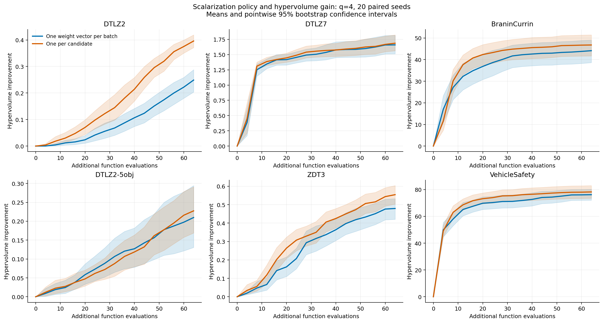
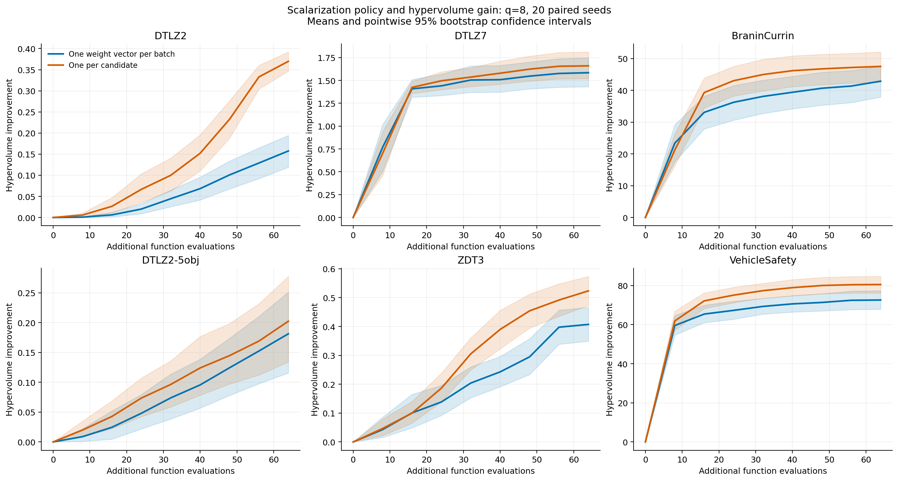

# Extended ParEGO scalarization benchmark

20 paired seeds for each problem and batch size; 16 initial observations and 64 additional evaluations. Both policies use sequential, pending-aware qLogNEI. Only the frequency of drawing a new scalarization changes.

Independent weights have a clear positive effect in 5 of the 12 cases and a clear negative effect in 0; 7 cases are inconclusive under this budget. Here, clear means the paired mean-difference interval excludes zero and the Holm-adjusted signed-rank p-value is below 0.05. This supports a problem-dependent interpretation rather than a universal performance claim.

## Design

- q=4: 16 rounds; q=8: 8 rounds. All end at 80 observations.
- The shared policy draws one trade-off direction per round; independent weights draw 64 over each run. Thus the shared policy samples twice as many directions at q=4 as at q=8 in this design.
- 128 MC samples, four restarts, 128 raw samples, maxiter=200; noiseless objectives, all minimized.
- 8 workers with one CPU thread each; CPU double precision; BoTorch 0.18.1, PyTorch 2.5.1.
- Initial designs and first scalarization per round are matched between policies. Separate random streams control weights, MC samplers, and optimizer initialization.
- Across 240 problem/batch-size/seed pairs, the largest coordinate difference between the first candidate of the first batch is 0. Logged weights are checked for unit sum and one distinct vector per batch versus per candidate.
- The original q=8 runs on DTLZ2, DTLZ7, and Branin–Currin are reused from the versioned November 4 archive. All q=4 runs and q=8 runs on the added problems are new. Runtime comparisons across batch sizes are affected by historical four-worker versus new eight-worker CPU contention.
- This compares experimental policy subclasses, rather than a before/after rerun of the production PR. New runs use source commit `939292f9e7e32dddf5d1a1c7e29824dbd9f630eb`. The manifest records the experiment runner's SHA-256 and dependency metadata; the source commit identifies the actual BoFire checkout.
- This is an exploratory extension of the original study. All problem/batch-size cases are reported. Paired tests use a single Holm correction across all 12 cases.

| Problem | Inputs | Objectives | Hypervolume reference point |
|---|---:|---:|---|
| DTLZ2 | 6 | 3 | [1.1, 1.1, 1.1] |
| DTLZ7 | 6 | 3 | [1.1, 1.1, 7.0] |
| BraninCurrin | 2 | 2 | [18.0, 6.0] |
| DTLZ2-5obj | 8 | 5 | [1.1, 1.1, 1.1, 1.1, 1.1] |
| ZDT3 | 6 | 2 | [1.1, 1.1] |
| VehicleSafety | 5 | 3 | [1864.72022, 11.81993945, 0.2903999384] |

## Quality curves

### q=4

### q=8

## Final paired comparison

Positive differences favor independent weights per candidate. Intervals bootstrap the paired seed differences with 20,000 resamples. Two-sided Wilcoxon signed-rank p-values are Holm-adjusted across the full study.

| Problem | q | Final HV: shared / per-candidate | Change | Wins / losses / ties | Paired difference, 95% CI | Adjusted p |
|---|---:|---:|---:|---:|---:|---:|
| DTLZ2 | 4 | 0.4227 / 0.5699 | +34.8% | 19 / 1 / 0 | +0.1472 [+0.0994, +0.2028] | 4.196e-05 |
| DTLZ7 | 4 | 1.6596 / 1.6865 | +1.6% | 12 / 8 / 0 | +0.0269 [-0.1458, +0.1957] | 1 |
| BraninCurrin | 4 | 52.2333 / 54.8742 | +5.1% | 15 / 5 / 0 | +2.6409 [+1.2328, +4.4879] | 0.008133 |
| DTLZ2-5obj | 4 | 0.4198 / 0.4374 | +4.2% | 12 / 8 / 0 | +0.0176 [-0.0674, +0.1005] | 1 |
| ZDT3 | 4 | 0.9789 / 1.0539 | +7.7% | 13 / 7 / 0 | +0.0750 [+0.0063, +0.1473] | 0.5838 |
| VehicleSafety | 4 | 221.8178 / 223.8709 | +0.9% | 15 / 5 / 0 | +2.0532 [-0.5356, +4.4756] | 0.5838 |
| DTLZ2 | 8 | 0.3315 / 0.5438 | +64.0% | 19 / 1 / 0 | +0.2123 [+0.1700, +0.2551] | 4.196e-05 |
| DTLZ7 | 8 | 1.5842 / 1.6595 | +4.8% | 15 / 5 / 0 | +0.0753 [-0.0680, +0.2063] | 0.5838 |
| BraninCurrin | 8 | 50.9855 / 55.6257 | +9.1% | 20 / 0 / 0 | +4.6402 [+3.3335, +6.1293] | 2.289e-05 |
| DTLZ2-5obj | 8 | 0.3912 / 0.4122 | +5.4% | 10 / 10 / 0 | +0.0210 [-0.0768, +0.1184] | 1 |
| ZDT3 | 8 | 0.9069 / 1.0232 | +12.8% | 13 / 7 / 0 | +0.1163 [+0.0376, +0.2001] | 0.1865 |
| VehicleSafety | 8 | 218.2592 / 226.1835 | +3.6% | 19 / 1 / 0 | +7.9243 [+5.4946, +10.8831] | 4.196e-05 |

## Candidate-generation cost

| Problem | q | Policy | Mean ask/batch | Total ask time |
|---|---:|---|---:|---:|
| DTLZ2 | 4 | One weight vector per batch | 3.38 s | 54.07 s |
| DTLZ2 | 4 | One per candidate | 2.79 s | 44.62 s |
| DTLZ7 | 4 | One weight vector per batch | 3.65 s | 58.38 s |
| DTLZ7 | 4 | One per candidate | 3.23 s | 51.64 s |
| BraninCurrin | 4 | One weight vector per batch | 2.61 s | 41.77 s |
| BraninCurrin | 4 | One per candidate | 2.14 s | 34.29 s |
| DTLZ2-5obj | 4 | One weight vector per batch | 5.74 s | 91.80 s |
| DTLZ2-5obj | 4 | One per candidate | 4.94 s | 79.11 s |
| ZDT3 | 4 | One weight vector per batch | 2.58 s | 41.23 s |
| ZDT3 | 4 | One per candidate | 2.59 s | 41.44 s |
| VehicleSafety | 4 | One weight vector per batch | 3.50 s | 56.05 s |
| VehicleSafety | 4 | One per candidate | 2.49 s | 39.84 s |
| DTLZ2 | 8 | One weight vector per batch | 6.33 s | 50.64 s |
| DTLZ2 | 8 | One per candidate | 4.68 s | 37.43 s |
| DTLZ7 | 8 | One weight vector per batch | 5.89 s | 47.15 s |
| DTLZ7 | 8 | One per candidate | 5.24 s | 41.94 s |
| BraninCurrin | 8 | One weight vector per batch | 4.73 s | 37.86 s |
| BraninCurrin | 8 | One per candidate | 3.72 s | 29.74 s |
| DTLZ2-5obj | 8 | One weight vector per batch | 12.07 s | 96.60 s |
| DTLZ2-5obj | 8 | One per candidate | 9.74 s | 77.94 s |
| ZDT3 | 8 | One weight vector per batch | 5.45 s | 43.64 s |
| ZDT3 | 8 | One per candidate | 5.46 s | 43.66 s |
| VehicleSafety | 8 | One weight vector per batch | 8.05 s | 64.36 s |
| VehicleSafety | 8 | One per candidate | 5.12 s | 40.92 s |

## Limits and artifacts

The results concern short-horizon synthetic front learning. They do not establish a universal advantage for every preference, noise level, reference point, or evaluation budget. Warnings are counted; automatic optimizer retries remain included in the recorded wall times. At equal evaluation budgets, q=4 has twice as many opportunities to refit the model and adapt to completed observations as q=8; this is distinct from the scalarization-policy comparison within each q. Independent random weights increase the number of sampled trade-offs but do not guarantee uniform Pareto-front coverage. Hypervolume alone does not establish uniform coverage. Inconclusive comparisons do not establish equivalence between the policies.

- [Configuration and provenance](manifest.json)
- [All per-round measurements](all_results.csv)
- [Paired statistics](paired_comparisons.csv)
- [Runtime summary](summary.csv)
- [Pairing checks](pairing_audit.csv)
- [Raw run and candidate archive](raw_runs.zip); extract here to restore q4/ and q8/ CSV files.
- [q=4 runtime curves](runtime_q4.png)
- [q=8 runtime curves](runtime_q8.png)
